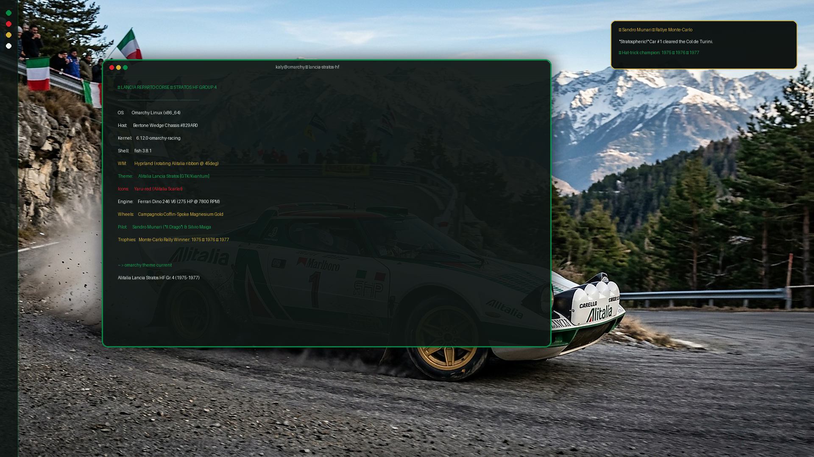

# Alitalia Lancia Stratos HF Group 4 — Omarchy Theme



A motorsport-inspired theme for [Omarchy Linux](https://omarchy.org/) celebrating the legendary **Lancia Stratos HF Group 4** (designed by Bertone / Marcello Gandini) in its iconic **Alitalia Racing** livery.

Honoring Sandro Munari (*"Il Drago"*) and Silvio Maiga's historic Monte Carlo Rally hat-trick (1975, 1976, 1977), this theme delivers an aggressive, distraction-free desktop experience with deep asphalt slate surfaces, vibrant Alitalia emerald green accents, scarlet red chevrons, and signature Campagnolo magnesium wheel gold highlights.

---

## Quick Install

Install directly via the Omarchy CLI:

```bash
omarchy theme install https://github.com/signorinacali/omarchy-alitalia-lancia-stratos-theme.git
```

Omarchy will automatically clone the theme, generate matching configurations across your system (Hyprland, Wayland bar, terminals, Neovim, btop, and lock screen), and apply it immediately.

---

## Color Palette

| Swatch | Color Name | Hex Code | Role |
|:---:|---|---|---|
| 🟢 | **Alitalia Emerald Green** | `#008C45` / `#12A153` | Primary Accent / Terminal Green / Livery Band |
| 🔴 | **Alitalia Scarlet Red** | `#D9232E` | Secondary Accent / Danger Alerts / Livery Chevron |
| 🟡 | **Campagnolo Wheel Gold** | `#D4AF37` / `#FCD34D` | Tertiary Accent / Terminal Yellow / Magnesium Star Wheels |
| ⚪ | **Rally Bianco** | `#FFFFFF` / `#EBF2ED` | High-contrast Text & Bodywork Pinstripe |
| 🌲 | **Asphalt Dark Forest** | `#0E1513` | Default Window Background (Deep Cockpit Tarmac) |
| ⬛ | **Midnight Louver Black** | `#090E0C` | Dark Background (Bar, Popups, Stratos Rear Louvers) |
| 🔘 | **Graphite Slate** | `#1B2623` | Selection & Inactive Surfaces |

---

## Rotating Alitalia Livery Border & Curved Windows (Hyprland Rice)

For the full motorsport rice experience — including **rounded windows**, **3px border width**, and the **continuously rotating 7-stop Alitalia + Campagnolo Gold ribbon** — add this block to your `~/.config/hypr/hyprland.lua` (or `~/.config/hypr/looknfeel.lua`):

```lua
-- ── Lancia Stratos HF Gr.4: Rotating Alitalia Livery Border Gradient ──
local alitalia_active_border = {
  colors = {
    "rgba(008C45F2)", -- Alitalia Emerald Green
    "rgba(FFFFFFF2)", -- Rally White Accent
    "rgba(D9232EF2)", -- Alitalia Scarlet Red Chevron
    "rgba(D4AF37F2)", -- Campagnolo Gold Center
    "rgba(D9232EF2)", -- Alitalia Scarlet Red Chevron
    "rgba(FFFFFFF2)", -- Rally White Accent
    "rgba(008C45F2)", -- Alitalia Emerald Green
  },
  angle = 45,
}

local alitalia_inactive_border = {
  colors = {
    "rgba(008C4555)",
    "rgba(D9232E33)",
    "rgba(D4AF3733)",
    "rgba(008C4555)",
  },
  angle = 45,
}

hl.config({
  general = {
    col = {
      active_border = alitalia_active_border,
      inactive_border = alitalia_inactive_border,
    },
    border_size = 3,
    gaps_in = 6,
    gaps_out = 14,
  },
  decoration = {
    rounding = 14,       -- Bertone curved wedge geometry
    dim_inactive = true,
    dim_strength = 0.12,
  },
  group = {
    col = {
      border_active = alitalia_active_border,
      border_inactive = alitalia_inactive_border,
      border_locked_active = alitalia_active_border,
      border_locked_inactive = alitalia_inactive_border,
    },
  },
})

-- Smooth circular animation: slowly rotates the Alitalia livery ribbon around the window
hl.animation({
  leaf = "borderangle",
  enabled = true,
  speed = 100,      -- ~10s per full rotation (ambient and smooth)
  bezier = "linear", -- Constant speed, zero stutter
  style = "loop",   -- Continuous loop
})
```

> **Performance Note**: The animation is executed purely via GPU fragment shaders in Hyprland with zero extra RAM impact (~0 MB). Hyprland automatically hot-reloads on save!

---

## Wayland Bar Styling (`shell.toml`)

This theme includes custom `shell.toml` styling tailored for the Omarchy Shell bar and surface popups:
* **Translucent Asphalt Bar**: Replaces plain white surfaces with deep cockpit tarmac (`#0E1513` @ 88% opacity).
* **Alitalia Active Indicators**: Alerts, recording, and critical states glow in `#D9232E` Scarlet Red.
* **Campagnolo Gold Hover**: Interactive modules glow warm gold on hover (`#D4AF37`).
* **Livery Border Matching**: Flyouts, popups, and notification cards share the rotating Alitalia active border.

---

## Sandro Munari Monte Carlo Easter Egg

Included in `hooks/theme-set.d/20-stratos-munari`: whenever this theme is applied, an authentic tribute notification triggers to celebrate Sandro Munari's legendary Col de Turini run:

```bash
# To enable this hook globally:
mkdir -p ~/.config/omarchy/hooks/theme-set.d
cp hooks/theme-set.d/20-stratos-munari ~/.config/omarchy/hooks/theme-set.d/
chmod +x ~/.config/omarchy/hooks/theme-set.d/20-stratos-munari
```

Notification Preview:
> **Sandro Munari — Rallye Monte-Carlo**  
> *"Stratospheric!"* Car #1 cleared the Col de Turini.  
> Hat-trick champion: 1975 • 1976 • 1977

---

## Included Wallpapers

The theme includes 5 high-resolution wallpapers tailored for distinct desktop moods:

1. **`0-hero-rally.jpg`** — Authentic rally action shot of Sandro Munari's #1 Stratos HF Group 4 drifting a mountain pass hairpin with gold Campagnolo wheels.
2. **`1-minimal-stripes.png`** — Native 4K (3840×2160) ultra-crisp vector SVG wallpaper: Bertone wedge diagonal Alitalia livery with Campagnolo gold pinstripes and Munari hat-trick telemetry.
3. **`2-night-stage.jpg`** — Atmospheric Col de Turini night rally with the menacing 4-pod Carello light rack cutting through alpine mist.
4. **`3-retro-ascii.png`** — 1970s green phosphor CRT terminal ASCII wireframe schematic of the Stratos wedge profile.
5. **`4-blueprint.jpg`** — Bertone architectural technical blueprint schematic with chassis dimensions and Ferrari Dino 2.4L V6 engine schematics on dark racing green drafting paper.

### Cycling Wallpapers

Cycle through the wallpapers at any time:

```bash
omarchy theme bg next
```

---

## Manual Installation (Local)

If you have cloned this repository locally:

```bash
# Symlink to Omarchy themes directory
ln -s "$(pwd)" ~/.config/omarchy/themes/alitalia-lancia-stratos

# Apply theme
omarchy theme set "alitalia-lancia-stratos"
```

---

## License

Distributed under the [MIT License](LICENSE).  
Wallpapers and rally imagery remain copyright of their respective creators and are included for personal desktop use.
