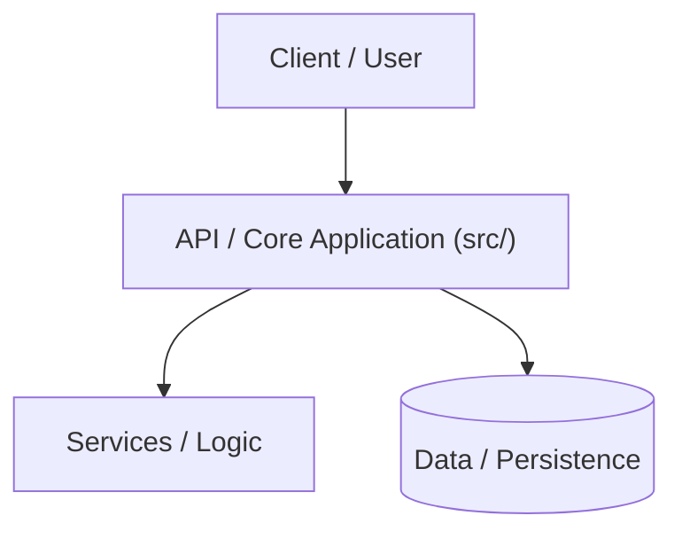

# Architecture & System Design: omarchy-alitalia-lancia-stratos-theme

## 🏛️ High-Level Design
Describe the high-level architecture and boundaries of the system.

## 📦 Key Components
- **Component A**: Description
- **Component B**: Description

## 🔒 Security & Data Flow
- Outline auth, state management, or security boundaries.
